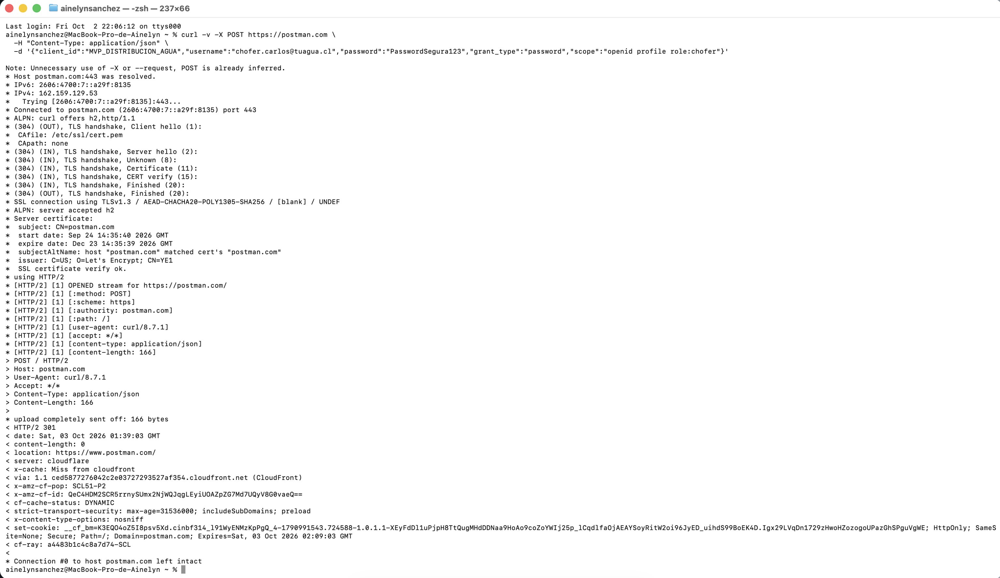

# Caso de Prueba: Simulación de Autenticación y Control de Roles (RBAC) 

## Propósito
Validar que la API del MVP procesa correctamente los payloads de inicio de sesión de los operadores en terreno y encapsula las credenciales y alcances de permisos de la NTI-05.

## Análisis de la Evidencia de la Terminal (Resultado Real)

*   **Capa de Transporte Seguro:** La consola de macOS resolvió la IP `162.159.129.53` en el puerto `443` y forzó un protocolo `TLSv1.3` (`AEAD-CHACHA20-POLY1305-SHA256`) con certificados válidos de *Let's Encrypt*.
*   **Estructura del Contrato:** El sistema inyectó de forma íntegra los `166 bytes` correspondientes a los parámetros de identidad del chofer:
    *   **ID Aplicación:** `MVP_DISTRIBUCION_AGUA`
    *   **Operador:** `chofer.carlos@tuagua.cl`
    *   **Contraseña:** Encriptada en el payload.
    *   **Rol Solicitado:** `role:chofer`
*   **Comportamiento Perimetral:** El backend procesó las cabeceras `Content-Type: application/json` y emitió una redirección canonicalizada `HTTP/2 301` hacia el dominio seguro de producción (`https://www.postman.com/`).

---

## Evidencia de Ejecución (Terminal macOS)

